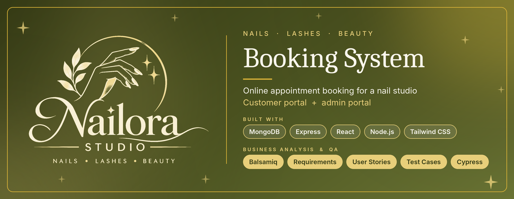
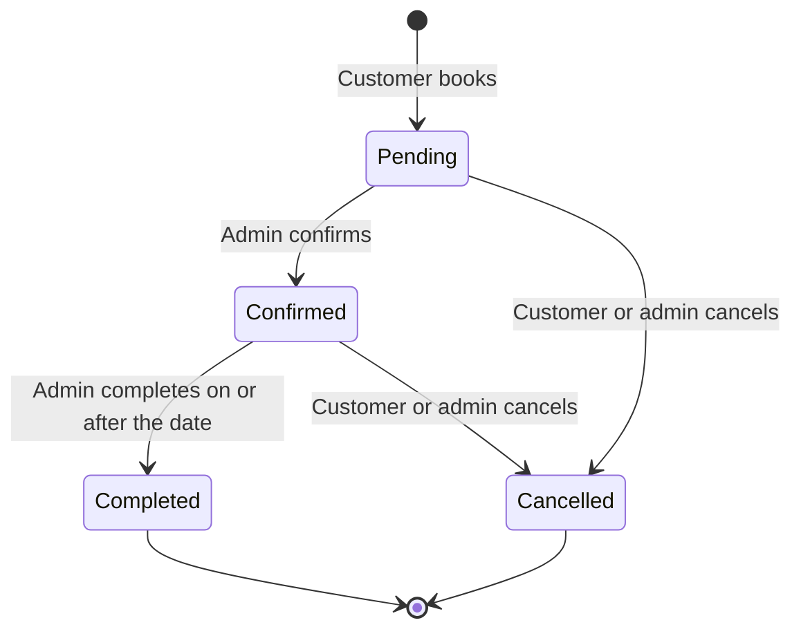

<p align="center">
  
</p>

<p align="center">
  
  
  
  
  
  
</p>

# Nailora Studio: Booking System

A full-stack appointment booking web app for a nail studio, built with the **MERN stack**. Customers browse services and book a time online; the studio owner manages services, opening hours and appointments from an admin portal.

The project covers the whole delivery cycle: **business analysis** (requirements, user stories, use cases, process flows, wireframes), **development** (React frontend, Express and MongoDB backend) and **quality assurance** (test plan, test cases, Cypress automation).

> **Project status:** Release 1 frontend is complete and runs on mock data. The Express and MongoDB backend is under development. Cypress automation is planned. See the [roadmap](#roadmap).

---

## Table of contents

- [Features](#features)
- [How booking works](#how-booking-works)
- [Tech stack](#tech-stack)
- [Project structure](#project-structure)
- [Getting started](#getting-started)
- [Documentation](#documentation)
- [Testing](#testing)
- [Roadmap](#roadmap)
- [Author](#author)

---

## Features

### Release 1 (MVP)

| Customer portal | Admin portal |
|---|---|
| Home with featured services and live opening hours | Dashboard: today's bookings, pending, upcoming and completed counts |
| Register and log in | Appointment Management: filter by status and date, confirm, cancel, complete |
| Services with category filter | Service Management: add, edit, hide or show, delete |
| Book Appointment with live available times | Salon Settings: weekly hours, closed days and dates, slot interval |
| Booking Confirmation | Role-based access (admin pages are protected) |
| My Appointments with cancel | |
| My Profile: edit details, change password | |
| About and Contact | |

### Release 2 (planned)

Customer: Reviews, Nail Art Gallery, FAQ. Admin: Staff, Customer, Gallery and Review management.

### Release 3 (planned)

Customer: email or WhatsApp reminders. Admin: reports and analytics.

<!--
## Screenshots

Add screenshots to docs/screenshots/ and remove this comment markers.

| Home | Book Appointment |
|---|---|
|  |  |

| Admin Dashboard | Appointment Management |
|---|---|
|  |  |
-->

---

## How booking works

The most important logic in the system is how available times are calculated and protected.

1. The customer chooses a service and a date.
2. The system checks the date is not a closed weekday or closed date, and not in the past.
3. It generates start times from the day's opening hours at the chosen slot interval (15, 30 or 60 minutes), keeping only times where the service finishes before closing.
4. It removes any time that overlaps an existing non-cancelled appointment, and times that have already passed today.
5. When the customer confirms, the system **checks for overlap again at save time**, so two customers cannot book the same time.
6. The booking starts as **Pending**; the studio owner confirms it.



---

## Tech stack

| Layer | Technology |
|---|---|
| Frontend | React (Vite), React Router, Tailwind CSS, Axios, TanStack Query |
| Backend | Node.js, Express, Mongoose |
| Database | MongoDB (Atlas) |
| Auth | JWT, bcrypt, role-based access (customer, admin) |
| Validation | express-validator |
| Testing | Manual test cases, Cypress end-to-end, Postman (API) |
| Design and analysis | Balsamiq wireframes, Mermaid diagrams, Markdown documentation |

---

## Project structure

```
nail-studio-booking-system/
├── client/                    React frontend
│   ├── public/                Logo, favicon
│   └── src/
│       ├── components/        Shared UI (Navbar, Footer, Card, Button, FormField, Logo)
│       ├── context/           AuthContext
│       ├── hooks/             useAuth
│       ├── layouts/           CustomerLayout, AdminLayout
│       ├── pages/
│       │   ├── customer/      Home, Services, BookAppointment, MyAppointments, ...
│       │   └── admin/         Dashboard, AppointmentManagement, ServiceManagement, SalonSettings
│       ├── routes/            AppRoutes, ProtectedRoute
│       ├── services/          Data layer (mock now, API calls after the backend is connected)
│       └── utils/             Slot generator and date helpers
├── server/                    Express backend
│   ├── config/                Database connection
│   ├── controllers/
│   ├── middleware/            Error handling, auth and role checks
│   ├── models/                User, Service, Appointment, SalonSettings
│   ├── routes/
│   └── server.js
├── docs/                      Business analysis and QA documentation
└── README.md
```

---

## Getting started

### Prerequisites

- Node.js 18.11 or newer
- Git
- A free [MongoDB Atlas](https://www.mongodb.com/atlas) cluster (needed for the backend)

### 1. Clone the repository

```bash
git clone https://github.com/<your-username>/nail-studio-booking-system.git
cd nail-studio-booking-system
```

### 2. Run the frontend

```bash
cd client
npm install
npm run dev
```

Open the address shown in the terminal (normally `http://localhost:5173`).

While the backend is being built, the frontend runs on **mock data stored in the browser**, so it works on its own. Each browser keeps its own data. To reset, clear the `nail_*` keys under DevTools, Application, Local Storage.

**Demo admin account (mock data only):**

| Email | Password |
|---|---|
| `admin@nailstudio.com` | `Admin@123` |

Register any customer account from the Register page.

### 3. Run the backend (in development)

```bash
cd server
npm install
```

Create `server/.env` from `server/.env.example`:

```
PORT=5000
MONGO_URI=your MongoDB Atlas connection string, ending in /nailora
JWT_SECRET=a long random string
JWT_EXPIRES_IN=7d
CLIENT_URL=http://localhost:5173
```

Generate a secret with:

```bash
node -e "console.log(require('crypto').randomBytes(32).toString('hex'))"
```

Start the server:

```bash
npm run dev
```

Check it at `http://localhost:5000/api/health`. It should return `{"status":"ok","db":"connected"}`.

> Never commit `.env`. It is listed in `.gitignore`.

---

## Documentation

All analysis and quality documents are in the [`docs`](docs/README.md) folder.

| Area | Documents |
|---|---|
| Business analysis | [Vision and scope](docs/ba/01-vision-scope-stakeholders.md), [Requirements](docs/ba/02-requirements.md), [User stories](docs/ba/03-user-stories.md), [Use cases](docs/ba/04-use-cases.md), [Process flows and data model](docs/ba/05-process-flows-and-data-model.md), [Wireframe guide](docs/ba/06-wireframe-guide.md), [Traceability matrix](docs/ba/07-traceability-matrix.md) |
| Quality assurance | [Test plan](docs/qa/01-test-plan.md), [Test cases](docs/qa/02-test-cases.md), [Cypress plan](docs/qa/03-cypress-automation-plan.md), [Defect log](docs/qa/04-defect-log.md) |

At a glance: 14 business rules, 36 functional requirements, 19 user stories for Release 1, 6 detailed use cases, 81 manual test cases, and a traceability matrix with no uncovered requirement.

---

## Testing

- **Manual:** 81 test cases covering accounts, services, booking, appointments, profile, all admin pages, and non-functional checks, each linked to a requirement.
- **Automation (planned):** a Cypress smoke suite and regression suite using the `data-cy` selectors already in the app. See the [Cypress plan](docs/qa/03-cypress-automation-plan.md).
- **API (backend phase):** Postman collections for auth, role checks and the booking overlap rule.

---

## Roadmap

| Item | Status |
|---|---|
| Requirements, user stories, use cases, process flows | Done |
| Test plan and 81 manual test cases | Done |
| Balsamiq wireframes | In progress |
| Release 1 frontend (customer and admin portals, mock data) | Done |
| Backend setup and database connection | In progress |
| Models, authentication and role checks | Planned |
| Services, settings, availability and booking API | Planned |
| Admin appointments and dashboard API | Planned |
| Connect frontend to the API | Planned |
| Cypress automation | Planned |
| Release 2: reviews, gallery, FAQ, staff, customer management | Planned |
| Release 3: reminders, reports and analytics | Planned |

---

## Author

**Hiruni Siyambalapitiya**
GitHub: [hiruni-siyambalapitiya](https://github.com/hiruni-siyambalapitiya)

> The studio details, prices and opening hours in this project are sample data created for a portfolio project.

